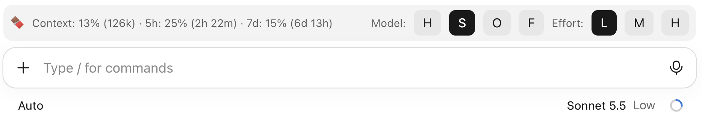
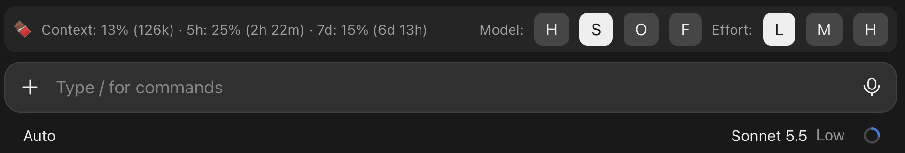

# EnergyBar

*EnergyBar* is a Claude Code plugin (mod) that puts a bar above the prompt with your context, 5-hour, and 7-day usage figures, and buttons to switch models and effort levels with one click. The normal usage indicator and switches are still there, but *EnergyBar* is always visible with big click targets. No more navigating messy, everchanging menus.

This mod came to be because the usage indicator "ring" went missing in Claude Code in releases after Claude 2.37337.1, which has numerous open issues requesting to bring it back ([#102176](https://github.com/anthropics/claude-code/issues/102176), [#102103](https://github.com/anthropics/claude-code/issues/102103), [#102094](https://github.com/anthropics/claude-code/issues/102094), [#102615](https://github.com/anthropics/claude-code/issues/102615), [#103918](https://github.com/anthropics/claude-code/issues/103918), [#103885](https://github.com/anthropics/claude-code/issues/103885), [#102133](https://github.com/anthropics/claude-code/issues/102133), [#102623](https://github.com/anthropics/claude-code/issues/102623), etc.), and Claude Code now has mod support.

## Screenshot

*EnergyBar* in light and dark mode.

<table>
<tr>
<td width="50%"></td>
<td width="50%"></td>
</tr>
</table>


## Quick start

1. Add this folder as a marketplace, since Claude Code installs plugins from marketplaces:

   ```bash
   claude plugin marketplace add /path/to/EnergyBar
   ```

2. Install it:

   ```bash
   claude plugin install energybar@energybar
   ```

3. Run `/reload-plugins` in Claude Code, since plugins are read at startup and on reload.
4. Look above the prompt. The bar should show a chocolate bar and a line like `Context: 12% (24k) · 5h: 8% (3h 10m) · 7d: 31% (4d 2h)`.

[INSTALL.md](INSTALL.md) covers the requirements, updating, and removing it.


## What the bar shows

| Item | Meaning |
| --- | --- |
| `Context:` | Percent of the context window used, with the token count in thousands. Shows `--` until Claude Code reports it. |
| `5h:` | Percent of the 5-hour limit used, with time left until it resets. |
| `7d:` | Percent of the 7-day limit used, with days and hours until it resets. |

The figures refresh when a Session starts or attaches, every 2 seconds for the first 30 seconds, and whenever Claude Code reports a new reading. The reset countdowns tick once a minute.


## Model and Effort buttons

| Buttons | What they do |
| --- | --- |
| `H` `S` `O` `F` | Run `/model` with haiku, sonnet, opus, or fable. |
| `L` `M` `H` | Run `/effort` with low, medium, or high. |

The active choice is highlighted. If you never pressed a button, the highlighted model is the one the Session is already using.


## Limits

- Four models and three effort levels are built in. Adding one means editing the `MODELS` or `EFFORTS` list in `hooks/register.tsx`, or just ask Claude to change it.
- Usage limits appear only when Claude Code reports them for your account. No limit data means no `5h:` or `7d:` entry.
- The `H` for Haiku and the `H` for high are different buttons in different groups.


## Compatibility

Written and used with Claude Code 2.1.306.


## License

GPL v2 or later. See [LICENSE](LICENSE).
